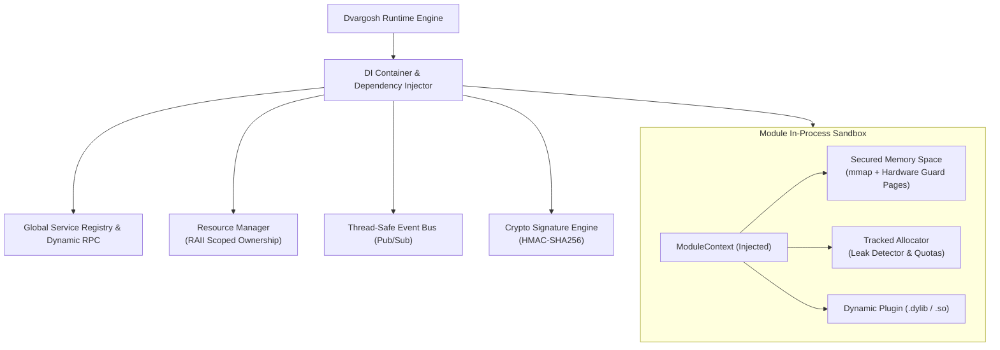

# Dvargosh 🛡️

**Dvargosh** is a modern C++17 plug-and-play modular framework featuring **in-process memory containerization**, **hardware-guarded secured memory spaces**, a **cryptographic module signature engine**, fine-grained **capability permissions**, a **global service registry**, **dynamic cross-module RPC dispatch**, and **dependency injection (DI)**.

---

## Architecture Overview



---

## Key Features

### 1. In-Process Secured Memory Space & Module Containerization
- **Hardware MMU Guard Pages**: Allocates memory via `mmap` with `PROT_NONE` boundary guard pages preceding and following the usable block. Any pointer underflow or overflow triggers an instant hardware page fault rather than silent host heap corruption.
- **Factory API**: `init_secured_memory_space(name, capacity_bytes, use_guard_pages)` provides instant secured memory containerization.
- **Memory Scrubbing**: Automatically zeroes out sensitive buffers upon container deallocation using volatile writes to prevent compiler dead-store elimination.
- **Memory Quotas**: Hard boundaries enforced on per-module memory consumption.

### 2. Cryptographic Signature System
- **Tamper-Proof Verification**: Modules must be cryptographically signed using HMAC-SHA256 before loading.
- **Pre-execution Gatekeeper**: If a `.dylib` or `.so` binary is modified or tampered with, the loader rejects it *before* `dlopen` execution.
- **Constant-Time Verification**: Prevents side-channel timing attacks during signature comparisons.

### 3. Fine-Grained Permission System
- **Capability Bits**: `Permission::SecuredMemory`, `Permission::ServiceRegister`, `Permission::DynamicInvoke`, `Permission::EventPublish`, `Permission::EventSubscribe`, `Permission::MemoryExpand`, `Permission::FileIO`, `Permission::NetworkAccess`.
- **Security Policies**: Strict, Standard, or Permissive profiles that enforce what APIs and operations a module can execute at runtime.

### 4. Global Service Registry & Dynamic Calling (RPC)
- **Typed Interface Registry**: Modules publish typed C++ interfaces (e.g. `ILogger`, `IMathService`) discoverable by name and version.
- **Dynamic Calling Dispatch**: Modules register and invoke methods dynamically by name (e.g. `registry->invoke("math.factorial", {Value(7)})`) with strongly-typed variant arguments.

### 5. Dependency Injection (DI) & Scoped Resource Management
- **Injected Context**: Modules receive an isolated `ModuleContext` containing their own secured memory container, tracked allocator, temporary scratchpad arena, and access to resolved services.
- **Zero-Leak Guarantee**: On module hot-unplug, the runtime automatically cleans up all resources, unregisters all methods, unsubscribes all event hooks, and audits allocations to verify 0 leaked bytes.

---

## Directory Layout

```
Dvargosh/
├── CMakeLists.txt              # Cross-platform build configuration
├── Makefile                    # Developer shortcut targets
├── Dockerfile                  # Multi-stage universal build container
├── docker-compose.yml          # Containerized test & verification services
├── .github/workflows/ci.yml    # CI/CD matrix workflow (Linux, macOS, Docker)
├── include/dvargosh/
│   ├── dvargosh.hpp            # Master umbrella header
│   ├── types.hpp               # Result<T>, StatusCode, Version, Value variant
│   ├── crypto.hpp              # SHA-256 and HMAC-SHA256 signature engine
│   ├── permissions.hpp         # Permission bitmasks and SecurityPolicy
│   ├── secured_memory.hpp      # Hardware-guarded secured memory space
│   ├── allocator.hpp           # System, Arena, and Tracked Allocator
│   ├── resource_manager.hpp    # Scoped RAII resource tracking
│   ├── event_bus.hpp           # Pub/Sub event bus
│   ├── registry.hpp            # Global service & dynamic RPC registry
│   ├── di_container.hpp        # Dependency Injection container & ModuleContext
│   ├── module.hpp              # Module interface & export macros
│   └── module_loader.hpp       # Dynamic library loader with signature enforcement
├── src/
│   ├── core/                   # Subsystem implementations
│   └── main.cpp                # CLI runner & automated verification harness
├── modules/                    # Plug-and-Play dynamic modules
│   ├── logger/                 # Logging service module
│   ├── math/                   # Math module (Arena allocator + Event publishing)
│   └── worker/                 # Worker module (Secured Memory Space + DI + RPC)
├── tests/                      # Comprehensive unit tests (CTest)
└── scripts/                    # Build and execution helper scripts
```

---

## Quickstart

### Native Build & Verification
Prerequisites: C++17 compatible compiler (Clang or GCC), CMake 3.16+, Make/Ninja.

```bash
# 1. Build project and modules
make build

# 2. Run unit test suite
make test

# 3. Run automated verification demo
make demo
```

### Interactive CLI Mode
```bash
make interactive
```
Available CLI commands:
- `load <path> [signature]` - Load a dynamic plugin
- `unload <name>` - Hot-unload module with scoped cleanup
- `reload <name>` - Hot-reload module
- `invoke <method> [args...]` - Invoke dynamic RPC method
- `services` - List registered interfaces
- `methods` - List callable dynamic methods
- `modules` - List active module containers
- `resources` - Audit active tracked resources
- `sign <path>` - Cryptographically sign a module binary

---

## Universal Docker Build & CI/CD

### Docker
```bash
# Build universal multi-stage container
make docker-build

# Run verification suite inside container
make docker-test

# Run interactive CLI inside container
make docker-interactive
```

### Docker Compose
```bash
# Run automated verification in container
docker compose run verify

# Run unit tests
docker compose run tests
```

### CI/CD Workflow
The repository includes a GitHub Actions pipeline (`.github/workflows/ci.yml`) that automatically:
1. Runs cross-platform matrix builds on **Ubuntu (GCC & Clang)** and **macOS (Apple Clang)**.
2. Executes the full CTest test suite with leak audits.
3. Builds the universal multi-stage Docker image and executes containerized verification.
