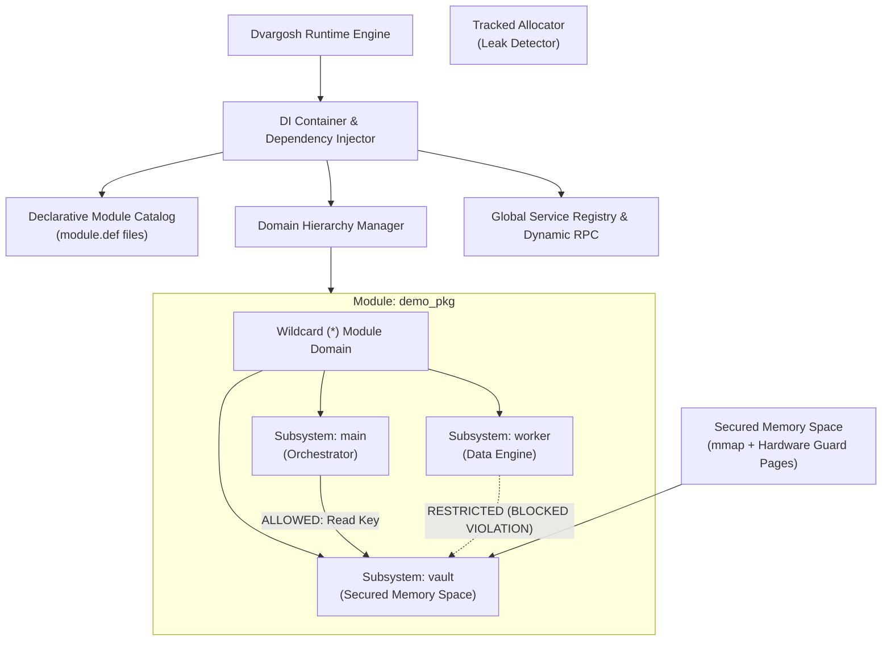

# Dvargosh 🛡️

**Dvargosh** is a modern C++17 plug-and-play modular framework featuring **in-process memory containerization**, **hardware-guarded secured memory spaces**, a **hierarchical domain (subsystem) architecture**, fine-grained **inter-subsystem access control**, **cryptographic module signatures**, a **declarative module manifest format with CMake generator tooling**, and **dynamic cross-module RPC dispatch**.

---

## Architecture & Conceptual Hierarchy

In Dvargosh:
- **Module / Package (`pkg`)**: The deployable dynamic library boundary (e.g., `demo_pkg`, `math`, `logger`, `monitor`).
- **Domains (`subsystems`)**: The logical sub-units or compartmentalized security sandboxes *within* a module (e.g., `main`, `vault`, `worker`, or wildcard `*`).
- **Services (`functions`)**: The interfaces and callable RPC methods published by domains.



---

## Key Features

### 1. Domains as Subsystems & Inter-Subsystem Access Control
- A module can contain multiple **domains (subsystems)**:
  - `demo_pkg:main`: Master orchestrator.
  - `demo_pkg:vault`: Protected credential storage with its own dedicated secured memory space.
  - `demo_pkg:worker`: Worker engine.
  - `*`: Module-wide root domain.
- **Access Restrictions**: Domains enforce access boundaries. For example, `demo_pkg:vault` allows calls from `demo_pkg:main`, but strictly denies calls from `demo_pkg:worker`, catching cross-domain security violations cleanly.

### 2. Auto-Resolving Module Loading by Name & Signature
- Load modules by name with known cryptographic signatures:
  ```cpp
  loader.load("demo_pkg", "expected_signature_hex");
  ```
  - Automatically searches configured search paths (`./build/modules`, `./modules`, etc.).
  - Resolves filenames (`libmod_<name>.dylib` or `.so`).
  - Verifies HMAC-SHA256 signature; returns `StatusCode::SignatureInvalid` if tampered or mismatched.

### 3. Domain-Level Secured Memory Spaces
- Allocate hardware-guarded memory spaces attached directly to domains:
  ```cpp
  dm->init_domain_space("compute", 1024 * 1024, true);
  ```
- Subsystems access their domain's secured space directly via `ctx.domain_space()`.

### 4. Telemetry & Live Memory Occupation Monitoring
- The `monitor` module inspects:
  - Host memory allocation (active bytes, peak bytes, allocation count).
  - Total secured memory capacity and utilized bytes.
  - Per-domain memory occupation, active module count, and registered services.
  - Dynamic RPC `monitor.memory_status` outputs a visual formatted dashboard.

### 5. Declarative Manifest Format (`module.def`) & Generator Tool
- Modules declare their structure in `module.def`:
  ```ini
  [module]
  name = demo_pkg
  version = 1.0.0
  description = Full Demo Package with Subsystems (Domains)
  secured_memory_kb = 4096
  domains = demo_pkg:main, demo_pkg:vault, demo_pkg:worker, *
  sources = demo_module.cpp
  link_libraries = dvargosh_core
  ```
- Tool (`tools/dvargosh_tool.py`) automatically scans `modules/` and:
  - Generates `modules/Modules.cmake` with targets and linkings.
  - Signs all compiled module binaries with HMAC-SHA256.

### 6. Module-Colocated Tests
- Tests for modules are located directly inside their module directories:
  - `modules/logger/test/test_logger.cpp`
  - `modules/math/test/test_math.cpp`
  - `modules/worker/test/test_worker.cpp`
  - `modules/monitor/test/test_monitor.cpp`
  - `modules/demo_pkg/test/test_demo_pkg.cpp`
- Framework unit tests remain in `tests/`.

---

## Directory Layout

```
Dvargosh/
├── CMakeLists.txt              # Cross-platform build configuration
├── Makefile                    # Developer shortcut targets
├── Dockerfile                  # Multi-stage universal build container
├── docker-compose.yml          # Containerized test & verification services
├── .github/workflows/ci.yml    # CI/CD matrix workflow (Linux, macOS, Docker)
├── tools/
│   └── dvargosh_tool.py        # Manifest parser, CMake generator, module signer
├── include/dvargosh/
│   ├── dvargosh.hpp            # Master umbrella header
│   ├── types.hpp               # Result<T>, StatusCode, Version, Value variant
│   ├── crypto.hpp              # SHA-256 and HMAC-SHA256 signature engine
│   ├── permissions.hpp         # Permission bitmasks and SecurityPolicy
│   ├── secured_memory.hpp      # Hardware-guarded secured memory space
│   ├── allocator.hpp           # System, Arena, and Tracked Allocator
│   ├── resource_manager.hpp    # Scoped RAII resource tracking
│   ├── event_bus.hpp           # Pub/Sub event bus
│   ├── domain.hpp              # Domain & Subsystem manager
│   ├── registry.hpp            # Global service & dynamic RPC registry
│   ├── di_container.hpp        # Dependency Injection container & ModuleContext
│   ├── module.hpp              # Module interface & export macros
│   ├── module_loader.hpp       # Dynamic library loader with signature enforcement
│   └── module_catalog.hpp      # Declarative module registration catalog
├── src/
│   ├── core/                   # Subsystem implementations
│   └── main.cpp                # CLI runner & overviewable demonstration harness
├── modules/                    # Plug-and-Play dynamic modules
│   ├── Modules.cmake           # Auto-generated CMake target definitions
│   ├── logger/                 # Logging service module + test/
│   ├── math/                   # Math module + test/
│   ├── worker/                 # Worker module + test/
│   ├── monitor/                # Telemetry & Memory occupation monitor + test/
│   └── demo_pkg/               # Full Demo Package (Subsystems & Access Control) + test/
└── tests/                      # Core framework unit tests (CTest)
```

---

## Quickstart

```bash
# 1. Auto-generate CMake configuration from module.def manifests
make generate-cmake

# 2. Build project and all dynamic modules
make build

# 3. Run all 23 unit tests (including all module tests)
make test

# 4. Run automated end-to-end overview demonstration
make demo

# 5. Interactive CLI REPL
make interactive
```

---

## Universal Docker Containerization

```bash
# Build multi-stage Docker container
make docker-build

# Run verification suite in Docker
make docker-test
```
